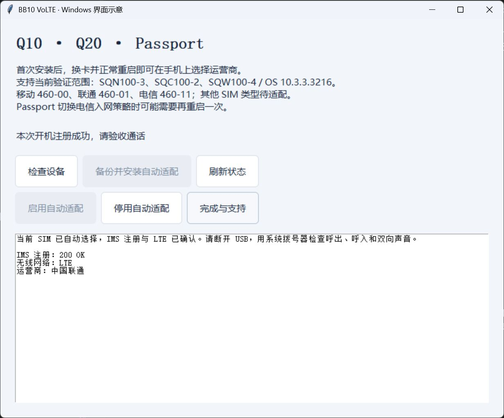

# bb10-volte — Q10, Q20, Passport and P’9983

**macOS maintenance ended (2026-11-09):** Due to limited maintenance capacity, **v0.5.0-r43 is the final macOS release**. No further maintenance or updates will be provided for macOS. Its installer and source remain available to download. This change does not affect Windows or the phone app.

**Desktop r62 · mobile 0.2.5.0.** Q10, Q20, Passport and P’9983 keep one-click mainland China profiles and include an offline global overseas carrier reference catalog (Apache-2.0 Schema 2, 297 entries) plus custom experimental configuration. The app labels untested carriers. Windows can place later downloads and new flash preparation on another disk.

The owner reports all three carriers passed on SQC100-1 and P’9983 SQK100-1. SQK100-2 is untested. SQW100-2 has no confirmed identity. You still need Root, OS 10.3.3.3216, matching native files and a backup you can restore.

[Model table](docs/COMPATIBILITY.en.md) · [Release notes](docs/RELEASE-r62.en.md)

Read the [network waiting, safe retry and optional selection guide](docs/NETWORK-RESILIENCE.en.md). The behavior remains in the current Windows download; device validation remains pending.

## What changed

- Windows can use another folder for downloads and for new Root or stock-upgrade preparation started afterward. The app still works when no folder is chosen. Existing files stay where they are, and a download, preparation or flash that has already started keeps its original folder.
- A missing, symlinked, junction, in-bundle, in-personal-directory or unwritable choice falls back to the original location, and the window says so. Connection, installation and status do not depend on this choice.
- Cleanup is a checklist. Each item shows its purpose and size, and nothing is checked by default. Keys, connection files, logs and flash records are never listed. Items still downloading, preparing or flashing cannot be checked. After flashing, the window asks about this run and defaults to keeping the files.
- Mobile remains 0.2.5.0 and macOS remains the frozen r43 release. This version adds no call, message or data acceptance.

## How to use it

- Not rooted: use Windows or Mac. Flashing erases the phone, so back up first.
- Rooted: install the phone app, then check, back up and turn it on there. You do not need the computer after that.
- Restart again only when the app asks. Power off before changing the SIM. Passport entering or leaving Telecom may need an extra normal restart.
- The computer needs Developer Mode. The phone app needs Root. If the computer cannot see the phone, use a cable that carries data.

## Apps disappear or a blue LED appears after a restart

A few BB10 phones lose apps or data and show a blue notification LED after a normal restart. This is a historical phone OS/data-partition problem, not something caused by VoLTE activation. The historical repair utility, hashes and results from two Q10 units are documented at [bb10-blue-led-recovery](https://github.com/Octo-o-o-o/bb10-blue-led-recovery). After a repair, create your own test file and restart normally to confirm; do not treat the tool's "Fixed" message alone as proof.

## BlackBerry Passport on Android 11 (LineageOS 18.1)

This repository (`bb10-volte`) targets stock **BlackBerry 10 (`OS 10.3.3.3216` / QNX)** only (SSH/BAR installer + `/radio/bin/ims_rrm` runtime). If your BlackBerry Passport has been flashed to **Android 11 (LineageOS 18.1)**, use our dedicated 32-bit Qualcomm Android 11 VoLTE/IMS stack sister project (`qcom32-volte`, with Passport `wolverine` as its first verified device profile):

- Official website & direct downloads: [qcom32-volte.octoooo.com](https://qcom32-volte.octoooo.com/en/)
- GitHub repository: [Octo-o-o-o/qcom32-volte](https://github.com/Octo-o-o-o/qcom32-volte)

## Companion App: BB10 Offline Call Recorder (`bb10-call-recorder`)

If you also want local call recording on your rooted BlackBerry 10 phone, check out our standalone companion project **[BB10 Call Recorder (`bb10-call-recorder`)](https://github.com/Octo-o-o-o/bb10-call-recorder)** — zero internet permissions, standard `16 kHz` WAV files playable natively on BB10, with both a native `.bar` and a one-click Windows helper:

- Website download section: [bb10-volte.octoooo.com/en/#recorder](https://bb10-volte.octoooo.com/en/#recorder)
- GitHub repository: [Octo-o-o-o/bb10-call-recorder](https://github.com/Octo-o-o-o/bb10-call-recorder)

## Downloads

| Computer | System requirements |
| --- | --- |
| Windows | **Windows 10 / Windows 11, 64-bit (x64)** |
| Mac · Apple Silicon | **macOS 11 Big Sur or later** |
| Mac · Intel | **macOS 10.15 Catalina or later** |

**Windows 7, Windows 8 / 8.1 and 32-bit Windows are not supported.** The Universal DMG includes both Apple Silicon and Intel architectures. **Initial Root preparation separately requires macOS 14 or later.**

Startup has been tried on Windows 11 and Apple silicon. Windows 10 and Intel have not. See the [Windows guide](docs/WINDOWS-EXE.en.md) and [Mac guide](docs/MACOS.en.md).

For excessive disk use after repeated preparation or failures, see [storage locations and manual cleanup](docs/DISK-CLEANUP.en.md). r43 includes preparation reuse and build cleanup fixes.

A [Windows UI redraw fix and comparison](docs/WINDOWS-UI-PERFORMANCE.en.md) remains included in the current Windows download below.

If GitHub is blocked, use the website’s Cloudflare R2 copy. Both are the same file. Check the SHA-256 before you run it.

| File | R2 direct download | GitHub alternative |
| --- | --- | --- |
| Windows x64 EXE | [Download](https://bb10-downloads.octoooo.com/v0.5.0-r62/bb10-volte-0.5.0-r62-windows-x64.exe) | [Download](https://github.com/Octo-o-o-o/bb10-volte/releases/download/v0.5.0-r62/bb10-volte-0.5.0-r62-windows-x64.exe) |
| macOS universal DMG (final: r43) | [Download](https://bb10-downloads.octoooo.com/v0.5.0-r43/bb10-volte-0.5.0-r43-macos-universal.dmg) | [Download](https://github.com/Octo-o-o-o/bb10-volte/releases/download/v0.5.0-r43/bb10-volte-0.5.0-r43-macos-universal.dmg) |
| Full source ZIP, including website | [Download](https://bb10-downloads.octoooo.com/v0.5.0-r62/bb10-volte-0.5.0-r62-experimental.zip) | [Download](https://github.com/Octo-o-o-o/bb10-volte/releases/download/v0.5.0-r62/bb10-volte-0.5.0-r62-experimental.zip) |
| SHA-256 checksums | [View](https://bb10-downloads.octoooo.com/v0.5.0-r62/SHA256SUMS.txt) | [View](https://github.com/Octo-o-o-o/bb10-volte/releases/download/v0.5.0-r62/SHA256SUMS.txt) |

EXE and DMG include Python and Tk. Windows includes SSH/SCP; Mac uses the system tools. The Windows EXE has no Authenticode publisher signature. The Mac app and DMG have Developer ID signatures, notarization and stapled tickets; Intel architecture is checked inside the package but has not run on Intel hardware. r14 adds Mac/Q20 first Root plus SMS and short bidirectional calls on Q20/Unicom and Passport/Mobile.

## Windows interface



Actual application UI using sanitized demonstration state, not a hardware acceptance screenshot. Windows and Mac share the same installation, restart and registration checks.

## Quick start

These steps are for the computer. A rooted phone can install the phone app instead.

1. Confirm the exact model, OS, VoLTE-enabled USIM without ISIM, Root SSH and trusted connection material. Automatic carrier installation is separate from first-time Root.
2. Run the Windows EXE or move the Mac app to Applications and launch it. Connect and unlock one phone, then open Automatic carriers.
3. Back up and install automatic carrier support. The application saves and downloads verified original settings before installation and readback.
4. Restart through the phone power menu, unlock and allow about 3–5 minutes. Select the recheck action. Follow any extra normal-restart prompt on Passport. Success requires the current boot, SIM, native IMS registration and LTE.
5. Unplug USB. Make and receive calls using the native dialer; wait for the connected timer to reach at least 00:35 for each. Check audio, LTE, carrier name and your own number.
6. Later, power off, swap the SIM and start normally. Passport entering or leaving Telecom may need about five minutes of initial startup followed by one more normal restart. Hot swapping is outside the accepted workflow.

Recognized old payloads are stopped and restored before upgrade. Restart to clear old runtime components, install/verify/enable the update, then restart to launch it. Keep original backups and update receipts. Unknown files, missing receipts, active calls and conflicting external changes stop writes. See [Automatic carriers](docs/AUTO-CARRIERS.en.md).

## First-time Root and connections

`0.5.0-r14` adds [old-OS upgrades and model matching](docs/FIRMWARE-UPGRADE.en.md), guarded phone-pairing commands, and exported instructions. Upgrading erases phone data and requires separate confirmation. Physical old-OS upgrade acceptance is pending.

An already-rooted phone with trusted SSH does not need reflashing. `0.5.0-r14` builds integrate automatic Root preparation and staged flashing for Q10, Classic (Q20), and Passport (Q30). Select firmware for the exact hardware variant; initial flashing erases data. Offline Windows builds and verification passed for all three firmware families. r14 passed first Root on Windows / Passport SQW100-4 and Apple Silicon Mac / Q20 SQC100-2, including new-key UID 0, fresh installation and normal-menu reboot autostart. Native stages ran through acceptance entry points; complete first-use GUI operation, Q10 first Root and Intel USB flashing remain unverified. Allow at least 15 GB. After importing firmware, prepare Root images before confirming flashing. See [First use](docs/FIRST-RUN.en.md).

Stock-firmware browser alternatives include [ZSpace](https://t3.znas.cn/9jkbxczhAK4) and Baidu links inside the app, with model-specific import checks. Those downloads are separate from the desktop EXE/DMG. See [First run](docs/FIRST-RUN.en.md), [Mac](docs/MACOS.en.md) and [GUI](docs/GUI.en.md).

## Source and build

```sh
git clone https://github.com/Octo-o-o-o/bb10-volte.git
cd bb10-volte
python tools/check_release.py --check-git
python tools/gui.py
```

Source execution requires Python 3.14 with Tk. The original `/radio/bin/ims_rrm` is preserved; installation uses a verified independent copy. Native hash mismatches stop installation. Fixed materials, provenance and licenses are recorded in [sources.json](materials/sources.json) and [NOTICE](NOTICE.md).

### Built-in AI Agent Skill

This repository ships a built-in Agent Skill at [`.agents/skills/bb10-volte/SKILL.md`](.agents/skills/bb10-volte/SKILL.md) paired with the headless JSON CLI [`tools/ai_skill.py`](tools/ai_skill.py). AI coding assistants such as Antigravity, Codex, Claude Code, and Cursor can discover the skill directly in the workspace (or install it via `npx skills add Octo-o-o-o/bb10-volte`) to safely identify connected BB10 hardware/OS/Root/SIM state and operate all **16 supported variants** (`SQN100-1..5`, `SQC100-1..5`, `SQW100-1..4`, `SQK100-1..2`) across pairing, native phone app installation, unified 3-carrier VoLTE setup/status/rollback, and owner-confirmed stock `10.3.3.3216` upgrade or AutoRoot workflows:

```sh
python tools/ai_skill.py detect
python tools/ai_skill.py models --variant SQC100-1
```

Software tests, frozen-package checks, signatures/notarization and actual phone calls are separate evidence. Public packages use an explicit allowlist and privacy scan, excluding keys, raw communications logs, numbers and device identifiers. The bilingual website and its tests are included; see [website/README](website/README.md).

[Windows](docs/WINDOWS-EXE.en.md) · [macOS](docs/MACOS.en.md) · [Build](docs/BUILD.en.md) · [Automatic carriers](docs/AUTO-CARRIERS.en.md) · [Contributing](CONTRIBUTING.md) · [Noncommercial license / Commercial paid](LICENSE)

Historical single-carrier restrictions remain in dated records; they do not replace the current unified workflow scope above. Share exact-model, redacted results in [Issues](https://github.com/Octo-o-o-o/bb10-volte/issues). Do not upload private keys, private directories or raw number logs.

## License and support

This project is licensed under the **[PolyForm Noncommercial License 1.0.0](LICENSE) (free noncommercial + paid commercial dual licensing)**: personal use, hobbyist experimentation, unpaid community sharing, academic research, educational and charitable noncommercial uses are **completely free**. Any commercial or for-profit use — including **paid flashing, installation, activation or support services, selling phones pre-installed or bundled with this software, or paid redistribution** — requires a separate prior paid commercial license from OctoLab via `octoooo@octoooo.com`.

After installation and verified registration, the completion page offers localized sharing, a GitHub Star link and optional coffee support. Sharing copies a message and the project website URL; you choose where to send it. Alipay and WeChat offer CNY 9.90 / 19.90 / 29.90 / a custom amount. Personal noncommercial use never requires payment; voluntary coffee tips are personal appreciation only and **do not grant a commercial license**. See [Completion and support](docs/SUPPORT.en.md).

Public packages contain the program, sanitized evidence and explicit public assets. They exclude SSH private keys, raw device logs, personal phone numbers, original payment screenshots and stock firmware. Public receipt codes use the OctoLab icon and preserve their payment destination. Check the recipient and amount in your payment app.

<sub>[Project website](https://bb10-volte.octoooo.com/en/) · [Made by OctoLab](https://octoooo.com/) · [Contact](mailto:octoooo@octoooo.com)</sub>
