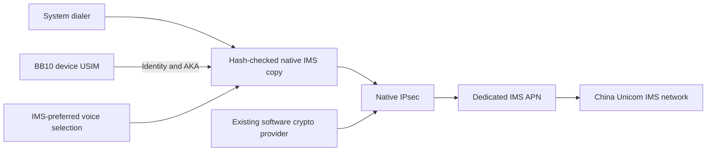

# bb10-volte — Experimental 4G Calling on BlackBerry 10


[简体中文](README.md) | **English**

**Repository status: temporarily Private. The maintainer will make it Public after stabilization.** The source uses the MIT license; these documents also prepare for that future public release.

An open-source toolkit enabling native VoLTE through the phone's own SIM, IMS stack and system dialer. Hardware call evidence covers **Q10 SQN100-3, BB10 OS 10.3.3.3216 and Beijing Unicom 460-01**. v0.3.0 recognizes Q10, Classic (Q20) and Passport (Q30) and supports editable operator JSON profiles. Q20/Q30 display “Not hardware validated; experimental use available.” Installation requires explicit opt-in and every technical gate passing.

**Tested on a real Q10 on October 27, 2026.** The latest hardened 0.3.1 version recovered automatically after a normal reboot and passed answered outgoing/incoming calls with the native dialer, two-way audio and continued 4G. Both have `INVITE 200 / ACK / BYE` evidence: approximately **7.362 seconds outgoing** and **4.674 seconds incoming**, with all 208 samples showing LTE / connected IMS. Root-ready to registration was approximately **4 minutes 42 seconds**; full boot duration was not measured. USB remained connected in this run; the afternoon unplugged-call trial is a [separate record](materials/call-acceptance-2026-10-27.json). See the [hardened-version acceptance](materials/startup-hardening-2026-10-27.json). This remains a **single-device experimental release**; 20-second or longer calls, long-term stability and other devices, firmware versions or carriers have not been validated.

[Windows EXE](docs/WINDOWS-EXE.en.md) · [macOS / DMG](docs/MACOS.en.md) · [Desktop GUI](docs/GUI.en.md) · [Compatibility](docs/COMPATIBILITY.en.md) · [Installation](docs/INSTALL.en.md) · [Validation evidence](docs/VALIDATION.en.md) · [Build from source](docs/BUILD.en.md) · [MIT license](LICENSE)

## What it does

- Creates a dedicated `ims` APN and derives IMS identities from the BB10 device's own USIM. Authentication stays with the SIM and native IMS implementation.
- Builds a hash-checked copy of the stock IMS program with an isolated platform configuration and a two-byte change to the ordinary voice VoPS decision.
- Enables the existing QNX software crypto provider and selects IMS-preferred voice through the native radio API.
- Installs a phone-side service with status, start, stop, update, disable, collection and recovery commands.
- Provides a Windows GUI, sanitized compatibility reports and a fixed workflow with a fresh phone-side gate before writing.
- Provides complete Python, shell and C source, a reproducible 5,264-byte helper, pinned material manifests and regression tests.

The stock `/radio/bin/ims_rrm` is not overwritten. Original firmware files must match the published SHA-256 values. The toolkit does not unlock a SIM, obtain free service or provide a separate calling account; it needs an active VoLTE-capable subscription.

## Tested environment and requirements

| Component | Requirement / recorded environment |
| --- | --- |
| Phone | **BlackBerry Q10 SQN100-3**; other Q10 variants and BB10 models are untested |
| Phone operating system | **BlackBerry 10 OS 10.3.3.3216**; the firmware archive is named `Q10_10.3.03.3216_SQN100-1-2-3-4-5.7z`. Exact native file hashes are enforced by the installer |
| SIM and network | **China Unicom 460-01 USIM in Beijing**, working LTE data and a subscription confirmed to support VoLTE; the tested SIM had no ISIM |
| Phone access | Working **root SSH**, the owner's private key and a verified host key; the service uses the AutoRoot v4 addon mechanism |
| Computer | **Windows 11 x64** was used; the Root preparation and USB driver workflows require Windows. macOS/Linux deployment has not been validated |
| Desktop Python | **Not required for EXE users**; source execution / full Root preparation uses Python 3.14 (tested 3.14.9), including Tk and Zstandard tar support |
| Device Python | BB10's built-in **Python 3.2**, with the native libraries checked by the installer |
| Connection | Reliable USB cable and BlackBerry USB networking; the EXE bundles SSH/SCP. Source execution and initial key preparation require OpenSSH separately |
| USB drivers | **BlackBerry USB Drivers 5.0.0.2 x64**; preparation checks file hashes and package/catalog signatures |
| Initial Root only | AutoRoot v4, Q10 stock firmware, **7-Zip**, libusb **1.0.30**, LZO **2.10-3**, and the pinned OpenSSL DLLs from **Git for Windows 2.55.0.windows.5 / OpenSSL 3.5.7**; allow about **15 GB** of workspace |
| Optional helper rebuild | **Zig 0.13.0**; no QNX SDK is needed to install the supplied helper |

Exact filenames, original download URLs and SHA-256 values are in [sources.json](materials/sources.json), [usb-drivers.json](materials/usb-drivers.json) and [stock-partitions.json](materials/stock-partitions.json). These are recorded working versions, not a request to use whichever version is newest. A hash mismatch stops preparation.

## Quick start

### Run the Windows EXE (recommended)

Obtain `bb10-volte-0.3.2-windows-x64.exe` from [Releases](https://github.com/Octo-o-o-o/bb10-volte/releases), or receive the file directly from the maintainer. Python, Tk, SSH, profiles and payload are embedded. Once model-specific root, USB networking and personal SSH configuration are prepared, preflight and installation need no desktop Internet connection. Initial rooting/drivers remain separate, and calls need carrier service. See [offline scope and test steps](docs/WINDOWS-EXE.en.md). The following instructions describe source execution.

### 1. Obtain the source

```powershell
git clone https://github.com/Octo-o-o-o/bb10-volte.git
cd bb10-volte
python --version
python tools/check_release.py
```

You can also extract the experimental ZIP from [Releases](https://github.com/Octo-o-o-o/bb10-volte/releases) and enter its top-level folder.

### 2. Prepare the phone connection

If the BB10 device already has matching root SSH and USB networking, use its existing verified SSH configuration. The examples below use `private/root-kit/ssh_config` and the alias `bb10-root`; older configurations may use `--host q10-root`. Substitute your own configuration path and `--host` alias when necessary.

For a stock phone, follow the [full installation guide](docs/INSTALL.en.md) to verify the USB drivers, obtain the pinned materials, create your own keys and build the Root images. **Initial Root flashing erases user data.** Back up the phone and keep a matching stock recovery image. The offline preparation scripts do not flash a phone.

### 3. Install and start VoLTE

Double-click **[Start-GUI.cmd](Start-GUI.cmd)** in the fully extracted release, select your own SSH configuration and run preflight. The GUI uses Python's bundled Tk without extra pip packages. See [the GUI guide](docs/GUI.en.md); initial Root flashing remains a separate procedure.

Alternatively, run the same workflow from the repository root:

```powershell
python tools/bb10.py preflight --ssh-config private/root-kit/ssh_config
python tools/bb10.py setup --ssh-config private/root-kit/ssh_config

# If registration is pending, check again later:
python tools/bb10.py status --ssh-config private/root-kit/ssh_config
```

`setup` installs, reads back the release, starts it and observes registration for a configurable duration (180 seconds by default). Look for `registration=verified`; `status` returns `registered=true` only with a live manager/native process and current connected IMS / 200 OK / LTE. A timeout reports pending, without reinstalling. First activation may briefly reload the radio. Registration alone does not establish working calls.

The revised 0.3.1 phone payload passed Q10 upgrade/readback, automatic normal-reboot recovery and short calls in both directions. Full phone installation through the final EXE was not separately repeated. Mobile, Telecom and other Unicom MNCs have untested templates. All OS, ABI, native hash, SIM and stock-carrier checks remain mandatory; ISIM is unsupported. CLI trials require `--allow-experimental`; custom profiles use `--profile path/to/profile.json`. Keep these options consistent for subsequent operations. Registration observation defaults to 180 seconds and is configurable.

See [profiles](docs/PROFILES.en.md) and [research](docs/CARRIER-RESEARCH.en.md). **Root firmware preparation remains Q10-only. Q20/Q30 testers must prepare root SSH for their own model; never flash the Q10 images onto them.**

### 4. Test calls and recovery

Use the system dialer to make and answer calls, verify sound in both directions, and check that the phone stays on 4G. Repeat after a reboot and after disconnecting USB. Follow the [acceptance checklist](docs/VALIDATION.en.md); these checks remain necessary for each installation.

After hanging up, stop and restore the project's changes with:

```powershell
python tools/bb10.py stop --ssh-config private/root-kit/ssh_config
python tools/bb10.py status --ssh-config private/root-kit/ssh_config
python tools/bb10.py check --ssh-config private/root-kit/ssh_config

# Also prevent the service from starting at the next Root startup:
python tools/bb10.py disable --ssh-config private/root-kit/ssh_config
```

Stop waits for restoration and returns `restored=true`. The preflight `baseline` check must pass, confirming policy 0, provider -1 and no IMS/VPN or override conflicts. `cleanup_required` means recovery needs investigation. See the [installation guide](docs/INSTALL.en.md) for updating, collecting private diagnostics and removing the startup entry.

## Validation status

| Check | Evidence / status |
| --- | --- |
| Dedicated IMS APN, AKA/IPsec, `REGISTER 200 OK` | Verified on Q10 |
| System-dialer outgoing call | Verified `INVITE 200`, `ACK`, normal `BYE` on 2026-10-27 |
| Answered incoming call | Afternoon persistent-service trial completed `INVITE 200 / ACK / BYE`, approximately 14.2 seconds after answer |
| LTE during the original call trial | All 366 sampled states were LTE |
| Two-way audio and operation without a computer | Owner completed both calls with USB disconnected, confirmed audio in both directions and 4G, then reconnected |
| Persistent service installation, registration, stop/restore and restart | Verified on Q10 |
| Persistent service beyond the old 30-minute trial window | Same instance remained registered on LTE from 15:34 to 16:32 (UTC+8) |
| Revised service after a normal reboot | Reboot at 16:36:20, registered at 16:44:02.121; no manual AppWorld launch or desktop service start |
| Afternoon persistent-service outgoing call | `INVITE 200 / ACK / BYE`, approximately 5.6 seconds after answer; all 64 trial samples showed LTE / IMS connected |
| Hardened 0.3.1 reboot and two-way calls | Automatic recovery passed; 7.362 s outgoing, 4.674 s incoming, all 208 samples LTE / IMS connected; USB connected in this run |
| Calls of at least 20 seconds, longer calls and long-term stability | **Further validation needed** |
| Other models, versions, carriers, roaming, handover, long-term standby and emergency calls | **Not tested** |

See [validation details](docs/VALIDATION.en.md), the [afternoon unplugged-call evidence](materials/call-acceptance-2026-10-27.json), [hardened-version reboot/call evidence](materials/startup-hardening-2026-10-27.json) and the [machine-readable summary](materials/validation-summary.json). The original logs contain private communications data and are not distributed. Automated tests do not replace hardware acceptance.

## How it works



The patch changes an isolated PPS configuration path and one ordinary-voice branch after the existing registration, RAT and service checks. Exact offsets, original/result hashes, API behavior and references are documented in [the design notes (Chinese)](docs/DESIGN.md). The separate emergency-call code is unchanged, but emergency calling has not been validated.

## Build and checks

```powershell
python -m unittest discover -s tests -v
python -m compileall -q device tools tests
python tools/check_release.py --check-git
python tools/package_release.py

# Optional: reproduce the supplied helper byte for byte
python tools/build_helper.py --zig C:\Tools\zig-0.13.0\zig.exe
```

`--check-git` verifies that Git tracks exactly the public file allowlist; omit it in an extracted ZIP. GitHub Actions runs the source checks and packaging on Windows and Linux. This checks desktop tooling and public packaging, not phone support on either host platform. See [build details](docs/BUILD.en.md).

## Repository layout

| Path | Contents |
| --- | --- |
| `device/` | Python 3.2 service, installer, native interfaces and recovery logic |
| `driver/` | Complete C helper source, export map and reproducible module |
| `tools/` | SSH controller, material preparation, build and release checks |
| `tests/` | Ownership, recovery, timeout, output and reboot-state regression tests |
| `materials/` | Source URLs, versions, hashes, payload manifest and evidence summary |
| `docs/` | Installation, design, build and validation guides |
| `docs/archive/` | Historical failures and troubleshooting conclusions |
| `downloads/`, `private/`, `build/`, `dist/` | Local inputs, keys, diagnostics and generated output; ignored by Git |

## Contributing and license

**If you use another BB10 OS version, Q10 variant or device model and encounter problems, please open an [Issue](https://github.com/Octo-o-o-o/bb10-volte/issues). [Pull requests](https://github.com/Octo-o-o-o/bb10-volte/pulls) with ports, fixes and test results are welcome.** The tested baseline remains Q10 SQN100-3 / BB10 OS 10.3.3.3216. New support requires independent validation rather than skipping firmware hash checks.

English and Chinese are both welcome; see [CONTRIBUTING.md](CONTRIBUTING.md). Provide model, full OS version, carrier MCC/MNC, project version and redacted status fields. Keep phone numbers, SIM/device identifiers, keys and raw SIP logs out of public issues.

Original project code, documentation and the source-built helper are released under the **[MIT License](LICENSE)**. BlackBerry/QNX firmware, stock IMS binaries, third-party Root tools and USB packages remain under their respective terms and are obtained separately from the pinned sources. See [NOTICE.md](NOTICE.md) for attribution and distribution boundaries.

## Acknowledgements

Special thanks to the authors and contributors of **[AutoRoot v4](https://bb10.root.sx/blog/autoroot-v4)** and **[bb10root / BB10 MultiTool (bb10mt)](https://github.com/bb10root/bb10mt)**. Their work on BB10 rooting, SSH access and firmware construction made this project's native IMS investigation and real-Q10 call validation possible. Our initial Root preparation builds on these tools. Please support the original projects and retain their attribution and license notices.
