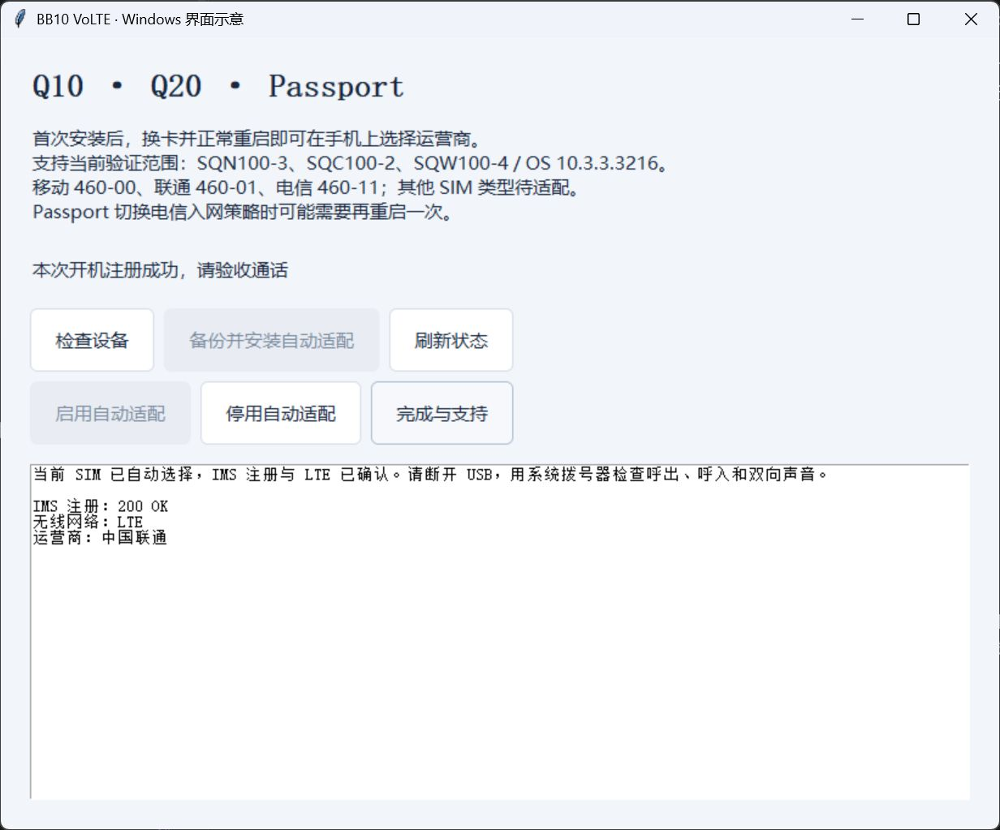

# bb10-volte — Q10, Q20, Passport and P’9983

**Desktop r42 · native mobile 0.1.0.43.** All catalog suffixes and three-carrier entries are open. Historical usable, untested, unsuccessful and known-issue results are shown separately, not used as activation vetoes.

SQC100-1 and P’9983 SQK100-1 now have explicit owner-reported three-carrier passes. SQK100-2 is officially documented but untested. SQW100-2 remains an unconfirmed production identity. Root, OS 10.3.3.3216, matching native files, current SIM identity and recoverable backups remain required.

[Exact-model matrix](docs/COMPATIBILITY.md) · [Per-unit manual progress](docs/INTAKE-MANUAL-PROGRESS.md) · [Release notes](docs/RELEASE-r42.md)

Already rooted: install the native BAR, then check, back up and enable from the phone. Computer pairing is optional for phone-only use. Not rooted: use the Windows or Mac guided preparation; firmware and loader identity must match before flashing. Power off before swapping SIMs, then restart normally. Restart again only when the app requests it.

Includes integrated computer pairing, recovery and upgrade improvements, action-needed notices, reduced stable-state polling/writes, the CTNET proxy correction and SMS association fixes. Some Telecom SMS are delivered but remain pending locally; do not resend already delivered messages. Historical per-model limitations remain visible in the matrix. No new integrated-release hardware acceptance or measured battery-saving percentage is claimed.

## Downloads

| Computer | System requirements |
| --- | --- |
| Windows | **Windows 10 / Windows 11, 64-bit (x64)** |
| Mac · Apple Silicon | **macOS 11 Big Sur or later** |
| Mac · Intel | **macOS 10.15 Catalina or later** |

**Windows 7, Windows 8 / 8.1 and 32-bit Windows are not supported.** The Universal DMG includes both Apple Silicon and Intel architectures. **Initial Root preparation separately requires macOS 14 or later.**

The Mac minimum versions were checked against the native binaries and libraries in the current release; they are not hardware validation of older macOS versions or Intel Macs. Packaging and startup have been verified on Windows 11 x64; Windows 10 x64 still awaits hardware testing. The Mac app has run on Apple Silicon, but has not been tested on Intel hardware. See the [Windows guide](docs/WINDOWS-EXE.en.md) and [Mac guide](docs/MACOS.en.md).

The website defaults to Cloudflare R2 and does not require GitHub connectivity. Both locations serve identical, version-matched files. Check the full SHA-256 before running. The alternative route does not guarantee reachability on every network.

| File | R2 direct download | GitHub alternative |
| --- | --- | --- |
| Windows x64 EXE | [Download](https://bb10-downloads.octoooo.com/v0.5.0-r42/bb10-volte-0.5.0-r42-windows-x64.exe) | [Download](https://github.com/Octo-o-o-o/bb10-volte/releases/download/v0.5.0-r42/bb10-volte-0.5.0-r42-windows-x64.exe) |
| macOS universal DMG | [Download](https://bb10-downloads.octoooo.com/v0.5.0-r42/bb10-volte-0.5.0-r42-macos-universal.dmg) | [Download](https://github.com/Octo-o-o-o/bb10-volte/releases/download/v0.5.0-r42/bb10-volte-0.5.0-r42-macos-universal.dmg) |
| Full source ZIP, including website | [Download](https://bb10-downloads.octoooo.com/v0.5.0-r42/bb10-volte-0.5.0-r42-experimental.zip) | [Download](https://github.com/Octo-o-o-o/bb10-volte/releases/download/v0.5.0-r42/bb10-volte-0.5.0-r42-experimental.zip) |
| SHA-256 checksums | [View](https://bb10-downloads.octoooo.com/v0.5.0-r42/SHA256SUMS.txt) | [View](https://github.com/Octo-o-o-o/bb10-volte/releases/download/v0.5.0-r42/SHA256SUMS.txt) |

EXE and DMG include Python and Tk. Windows includes SSH/SCP; Mac uses the system tools. The Windows EXE has no Authenticode publisher signature. The Mac app and DMG have Developer ID signatures, notarization and stapled tickets; Intel architecture is checked inside the package but has not run on Intel hardware. r14 adds Mac/Q20 first Root plus SMS and short bidirectional calls on Q20/Unicom and Passport/Mobile.

## Windows interface



Actual application UI using sanitized demonstration state, not a hardware acceptance screenshot. Windows and Mac share the same installation, restart and registration checks.

## Quick start

1. Confirm the exact model, OS, VoLTE-enabled USIM without ISIM, Root SSH and trusted connection material. Automatic carrier installation is separate from first-time Root.
2. Run the Windows EXE or move the Mac app to Applications and launch it. Connect and unlock one phone, then open Automatic carriers.
3. Back up and install automatic carrier support. The application saves and downloads verified original settings before installation and readback.
4. Restart through the phone power menu, unlock and allow about 3–5 minutes. Select the recheck action. Follow any extra normal-restart prompt on Passport. Success requires the current boot, SIM, native IMS registration and LTE.
5. Unplug USB. Make and receive calls using the native dialer; wait for the connected timer to reach at least 00:35 for each. Check audio, LTE, carrier name and your own number.
6. Later, power off, swap the SIM and start normally. Passport entering or leaving Telecom may need about five minutes of initial startup followed by one more normal restart. Hot swapping is outside the accepted workflow.

Recognized old payloads are stopped and restored before upgrade. Restart to clear old runtime components, install/verify/enable the update, then restart to launch it. Keep original backups and update receipts. Unknown files, missing receipts, active calls and conflicting external changes stop writes. See [Automatic carriers](docs/AUTO-CARRIERS.en.md).

## First-time Root and connections

`0.5.0-r14` adds [old-OS upgrades and model matching](docs/FIRMWARE-UPGRADE.en.md), guarded phone-pairing commands, and exported instructions. Upgrading erases phone data and requires separate confirmation. Physical old-OS upgrade acceptance is pending.

An already-rooted phone with trusted SSH does not need reflashing. `0.5.0-r14` builds integrate automatic Root preparation and staged flashing for Q10, Classic (Q20), and Passport (Q30). Select firmware for the exact hardware variant; initial flashing erases data. Offline Windows builds and verification passed for all three firmware families. r14 passed first Root on Windows / Passport SQW100-4 and Apple Silicon Mac / Q20 SQC100-2, including new-key UID 0, fresh installation and normal-menu reboot autostart. Native stages ran through acceptance entry points; complete first-use GUI operation, Q10 first Root and Intel USB flashing remain unverified. Allow at least 15 GB. After importing firmware, prepare Root images before confirming flashing. See [First use](docs/FIRST-RUN.en.md).

Stock-firmware browser alternatives include [ZSpace](https://t3.znas.cn/9jkbxczhAK4) and Baidu links inside the app, with model-specific import checks. Those downloads are separate from the desktop EXE/DMG. See [First run](docs/FIRST-RUN.en.md), [Mac](docs/MACOS.en.md) and [GUI](docs/GUI.en.md).

## Source and build

```sh
git clone https://github.com/Octo-o-o-o/bb10-volte.git
cd bb10-volte
python tools/check_release.py --check-git
python tools/gui.py
```

Source execution requires Python 3.14 with Tk. The original `/radio/bin/ims_rrm` is preserved; installation uses a verified independent copy. Native hash mismatches stop installation. Fixed materials, provenance and licenses are recorded in [sources.json](materials/sources.json) and [NOTICE](NOTICE.md).

Software tests, frozen-package checks, signatures/notarization and actual phone calls are separate evidence. Public packages use an explicit allowlist and privacy scan, excluding keys, raw communications logs, numbers and device identifiers. The bilingual website and its tests are included; see [website/README](website/README.md).

[Windows](docs/WINDOWS-EXE.en.md) · [macOS](docs/MACOS.en.md) · [Build](docs/BUILD.en.md) · [Automatic carriers](docs/AUTO-CARRIERS.en.md) · [Contributing](CONTRIBUTING.md) · [MIT license](LICENSE)

Historical single-carrier restrictions remain in dated records; they do not replace the current unified workflow scope above. Share exact-model, redacted results in [Issues](https://github.com/Octo-o-o-o/bb10-volte/issues). Do not upload private keys, private directories or raw number logs.

## Sharing and support

After installation and verified registration, the completion page offers localized sharing, a GitHub Star link and optional coffee support. Sharing copies a message and the project website URL; you choose where to send it. Alipay and WeChat offer CNY 9.90 / 19.90 / 29.90 / a custom amount. All features remain available without contributing. See [Completion and support](docs/SUPPORT.en.md).

Public packages contain the program, sanitized evidence and explicit public assets. They exclude SSH private keys, raw device logs, personal phone numbers, original payment screenshots and stock firmware. Public receipt codes use the OctoLab icon and preserve their payment destination. Check the recipient and amount in your payment app.

<sub>[Project website](https://bb10-volte.octoooo.com/en/) · [Made by OctoLab](https://octoooo.com/) · [Contact](mailto:octoooo@octoooo.com)</sub>
