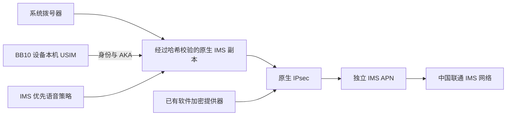

# bb10-volte — 黑莓 BB10 4G 通话工具


**简体中文** | [English](README.en.md)

为运行 **BlackBerry 10（BB10）** 的 **Q10、Classic（Q20）、Passport（常称 Q30）** 启用原生 **VoLTE / 4G 通话**，提供源码、Windows EXE 和 macOS DMG，项目采用 [MIT 许可证](LICENSE)。

**项目背景：** 这些 4G 手机原本可在 4G 下使用短信和数据，语音通话却会回落到 2G / 3G；随着所在地区运营商的 2G / 3G 退网，默认语音通话可能无法使用，因此有了这个项目。

**手机无需改动硬件，但需要通过 AutoRoot 获得 Root 权限。** 启用后继续使用手机自己的 SIM、原生 IMS 协议栈和系统拨号器。VoLTE 功能由本项目提供，无需再安装其他 VoLTE 项目或手机通话 App；EXE / DMG 用户无需另装 Python。首次 Root 和连接准备的实际范围见[使用方式](#使用方式)及[完整安装指南](docs/INSTALL.md)。

**目前唯一实测组合是 Q10 SQN100-3＋BB10 OS 10.3.3.3216＋北京中国联通（460-01）。** 已验证手机菜单重启后自动注册，以及拔掉 USB 后的系统拨号器呼入、呼出、双向声音和通话全程 4G，详见[实机验收](materials/startup-latency-2026-10-28.json)。Q20、Passport、其他 Q10 版本和运营商也有望使用，但尚未实测，需要通过兼容性检查后实验试用，不能保证可用。欢迎测试过的朋友提交[反馈](https://github.com/Octo-o-o-o/bb10-volte/issues)，**可用和不可用的结果都欢迎**。当前版本仍属实验版，长通话与长期稳定性有待补充验证。

[Windows EXE](docs/WINDOWS-EXE.md) · [macOS / DMG](docs/MACOS.md) · [桌面 GUI](docs/GUI.md) · [兼容性矩阵](docs/COMPATIBILITY.md) · [完整安装](docs/INSTALL.md) · [实机验收记录](docs/VALIDATION.md) · [源码构建](docs/BUILD.md) · [MIT 许可证](LICENSE)

## 项目功能

- 创建独立 `ims` APN，从 BB10 设备本机 USIM 派生 IMS 身份，由 SIM 和原生 IMS 完成认证。
- 生成经过哈希校验的原生 IMS 副本，使用隔离的平台配置，并修改普通语音 VoPS 判断的两个字节。
- 启用 QNX 已有的软件加密提供器，通过原生无线接口选择 IMS 优先语音。
- 安装手机端常驻服务，提供状态、启动、停止、更新、停用、采集及恢复命令。
- 提供 Windows / macOS 桌面 GUI、脱敏兼容性报告和固定安装流程；安装前在手机上重新检查，文件不符或状态未知时停止。
- 公开完整 Python、shell、C 源码、可复现构建的 5,264 字节辅助模块、固定材料清单和回归测试。

原厂 `/radio/bin/ims_rrm` 不被覆盖，原生文件必须匹配公开的 SHA-256。这里的“解锁”指启用原生 VoLTE 通话能力；需要本身已开通 VoLTE 的有效套餐，不提供 SIM 解锁、免费通话或独立网络电话账号。

## 所需环境与实测配置

| 组件 | 要求 / 已记录的测试环境 |
| --- | --- |
| 手机 | **Q10 SQN100-3** 已实测；其他 Q10 变体、Q20 / Q30 仅在全部技术检查通过后允许实验试用 |
| 手机系统（OS） | **BlackBerry 10 OS 10.3.3.3216**；固件包文件名写作 `Q10_10.3.03.3216_SQN100-1-2-3-4-5.7z`，安装器严格检查原生文件哈希 |
| SIM 与网络 | **北京中国联通 460-01 USIM**，4G 数据正常，套餐已确认支持 VoLTE；实测卡没有 ISIM |
| 手机访问 | 可用的 **Root SSH**、个人私钥和已验证的主机密钥；服务使用 AutoRoot v4 的 addon 机制 |
| 电脑 | 实测 **Windows 11 x64**；Root 准备与 USB 驱动流程需要 Windows，macOS/Linux 部署未验证 |
| 电脑 Python | **EXE / DMG 用户无需安装**；源码运行 / 完整 Root 准备使用 Python 3.14（本次 3.14.9），含 Tk 和 Zstandard tar 支持 |
| 手机 Python | BB10 自带 **Python 3.2**，以及安装器校验的原生库 |
| 连接 | 稳定的 USB 数据线与 BlackBerry USB 网络；EXE 内置 `ssh` / `scp`，Windows 源码用户缺少 SSH 时，向导可自动获取连接组件 |
| USB 驱动 | **BlackBerry USB Drivers 5.0.0.2 x64**，准备流程核验文件哈希和安装包 / CAT 签名 |
| 仅首次 Root 所需 | AutoRoot v4、Q10 原版固件、**7-Zip**、libusb **1.0.30**、LZO **2.10-3**、**MinGit 2.55.0.5 / OpenSSL 3.5.7** 中的固定 DLL；向导自动获取，建议预留约 **15 GB** |
| 可选辅助模块重建 | **Zig 0.13.0**；安装随仓库提供的模块无需 QNX SDK |

精确文件名、原始下载地址及 SHA-256 见 [sources.json](materials/sources.json)、[usb-drivers.json](materials/usb-drivers.json)、[stock-partitions.json](materials/stock-partitions.json)。这些是已经记录的可工作版本，不应直接用最新版替换；散列不匹配时准备流程会停止。

## 快速开始

### 使用方式

从 [Releases](https://github.com/Octo-o-o-o/bb10-volte/releases) 获取对应平台的安装包或源码包，并核对同名 `.sha256` 文件。

| 方式 | 如何启动 | 说明 |
| --- | --- | --- |
| **Windows EXE** | 下载 Windows x64 `.exe`，双击启动 | 内置 Python、Tk、SSH/SCP、运营商配置和手机端载荷；无需另装 Python 或 OpenSSH，见 [EXE 指南](docs/WINDOWS-EXE.md) |
| **macOS DMG** | 下载 macOS `.dmg`，将应用拖入“应用程序”后启动 | 内置 Python 和 Tk，使用 macOS 自带 SSH/SCP；发布包签名、公证及实测范围见 [Mac 指南](docs/MACOS.md) |
| **源码** | 克隆仓库或解压源码 ZIP，运行 `python tools/gui.py` | 需要 Python 3.14（含 Tk）；Windows 向导可自动获取 SSH，macOS 使用系统 SSH；Windows 也可双击 `Start-GUI.cmd`，无需额外 pip 包 |

三种方式共用机型识别、运营商配置、预检与 VoLTE 安装流程。**Windows 的“首次使用”向导可自动获取、校验工具和 Q10 固件，生成个人密钥、构建 Root 镜像，并在用户单独确认清空数据后顺序刷写；无需另装其他 Root 项目、Git 或 7-Zip。** 初次刷写分支仍属实验功能，未在未 Root 手机上实刷验收。Mac 当前支持已 Root 手机的连接与使用提示，首次 Root 请先在 Windows 完成。Q20 / Passport 的首次 Root 仍需匹配机型的方法，禁止刷入 Q10 镜像。详见[首次使用指南](docs/FIRST-RUN.md)。Mac 直连手机通话仍未验收。

首次 Root 刷写会清空手机数据，请先备份。已有匹配 Root 和连接配置时，可以直接打开应用检查设备、选择运营商并安装 VoLTE 服务；准备完成后的预检与安装不需要电脑联网，手机注册与通话仍需要运营商服务。以下为源码方式。

### 1. 获取源码

```powershell
git clone https://github.com/Octo-o-o-o/bb10-volte.git
cd bb10-volte
python --version
python tools/check_release.py
```

也可从 [Releases](https://github.com/Octo-o-o-o/bb10-volte/releases) 下载实验版 ZIP，解压后进入其顶层目录。

### 2. 准备手机连接

已有匹配 Root、USB 网络和 SSH 的 BB10 设备，可以直接使用原来的已验证 SSH 配置。下文以 `private/root-kit/ssh_config` 和 `bb10-root` 别名为例；旧配置可通过 `--host q10-root` 指定兼容别名；使用另一份配置时替换路径，必要时加 `--host` 指定自己的别名。

尚未 Root 的 Q10 请先按 [完整安装指南](docs/INSTALL.md) 准备驱动、个人密钥与对应镜像；其他 BB10 机型必须使用各自机型的固件和 Root 方法。**首次 Root 刷写会清空用户数据**，先备份并保留对应的原版恢复镜像。离线材料准备脚本本身不会刷写手机。

### 3. 安装并启动 VoLTE

源码用户在完整解压的目录双击 **[Start-GUI.cmd](Start-GUI.cmd)**，选择个人 SSH 配置后点击“检查设备”。桌面构建 `0.3.2-r3` 默认展示结论和待处理项，完整检查、报告与维护功能按需打开；手机端载荷版本为 `0.3.2`。界面使用 Python 自带 Tk，无需额外 pip 包；详见 [GUI 指南](docs/GUI.md)。初次 Root 可从“首次使用”进入，详见首次使用指南。

或在仓库根目录执行同一套流程：

```powershell
python tools/bb10.py preflight --ssh-config private/root-kit/ssh_config
python tools/bb10.py setup --ssh-config private/root-kit/ssh_config

# 如注册仍待确认，稍后查看状态：
python tools/bb10.py status --ssh-config private/root-kit/ssh_config
```

`setup` 固定执行安装、回读、启动和可配置的注册观察（默认 180 秒）。应看到 `registration=verified`；`status` 输出中 `registered=true` 同时要求管理器与原生 IMS 存活、当前 IMS connected / 200 OK / LTE。超时显示 pending，不自动重装。第一次启动可能短暂重载无线网络。注册成功本身不能证明实际通话成功。

v0.3.2 修订手机端已通过 Q10 升级回读、手机菜单重启自动恢复及拔 USB 双向短通话验收；最终 EXE 的完整手机安装未另行复测。移动、电信及其他联通 MNC 可选择模板或编辑参数后勾选实验试用，仍需满足 OS、ABI、原生哈希、SIM 和原厂配置检查；ISIM 仍不支持。CLI 试用添加 `--allow-experimental`，自定义配置添加 `--profile path/to/profile.json`，后续操作沿用相同选项。注册观察默认 180 秒，可在配置中修改。

见 [配置指南](docs/PROFILES.md) 和 [资料调研](docs/CARRIER-RESEARCH.md)。**Root 固件准备仍为 Q10 专用；Q20 / Q30 必须准备对应机型的 Root SSH，不得使用 Q10 镜像刷写。**

### 4. 实际通话与恢复

使用系统拨号器呼出、接听，逐项确认双方声音与全程 4G；重启后和断开 USB 后分别复测。每台安装设备都应完成 [验收清单](docs/VALIDATION.md)。

挂断电话后，停止并恢复本项目的配置：

```powershell
python tools/bb10.py stop --ssh-config private/root-kit/ssh_config
python tools/bb10.py status --ssh-config private/root-kit/ssh_config
python tools/bb10.py check --ssh-config private/root-kit/ssh_config

# 同时禁止下次 Root 启动时自动运行：
python tools/bb10.py disable --ssh-config private/root-kit/ssh_config
```

停止命令等待恢复，并返回 `restored=true`；预检的 `baseline` 项应通过，表示已回读原语音策略 `0`、软件提供器 `-1`、无 IMS/VPN 和覆盖冲突。`cleanup_required` 表示恢复需要排查。更新、私有诊断采集和移除启动入口的步骤见 [安装指南](docs/INSTALL.md)。

## 测试验证范围

| 检查 | 证据 / 状态 |
| --- | --- |
| 独立 IMS APN、AKA/IPsec、`REGISTER 200 OK` | Q10 实机通过 |
| 系统拨号器呼出 | 2026-10-27 实测 `INVITE 200`、`ACK`、正常 `BYE` |
| 来电接听 | 下午常驻版试验完成 `INVITE 200 / ACK / BYE`，接通后约 14.2 秒 |
| 原始通话试验期间保持 LTE | 366 个采样状态全部为 LTE |
| 双向声音与脱离电脑 | 机主在拔掉 USB 后完成呼入、呼出并确认双方声音和 4G，随后重新连接 |
| 常驻服务安装、注册、停止恢复、再次启动 | Q10 实机通过 |
| 常驻服务超过原 30 分钟窗口 | 15:34 启动的同一实例在 16:32 仍注册在线并保持 LTE（UTC+8） |
| 修订版正常重启后自动恢复 | 16:36:20 重启，16:44:02.121 注册成功；无需手动打开 AppWorld 或电脑启动服务 |
| 下午常驻版呼出 | `INVITE 200 / ACK / BYE`，接通后约 5.6 秒；本轮 64 个状态样本全部为 LTE / IMS connected |
| 0.3.1 加固版重启与双向通话 | 自动恢复通过；呼出 7.362 秒、呼入 4.674 秒，208 个样本保持 LTE / IMS connected；本轮 USB 连接 |
| 0.3.2 提速版重启与双向通话 | 手机菜单重启后自动恢复；拔 USB 呼入 6.088 秒、呼出 5.894 秒；163 个样本 LTE / IMS connected |
| 至少 20 秒及更长通话、长期稳定性 | **仍需补充验证** |
| 其他机型、系统、运营商、漫游、切换小区、长期待机、紧急呼叫 | **未测试** |

详见 [验收记录](docs/VALIDATION.md)、[下午断开 USB 通话证据](materials/call-acceptance-2026-10-27.json)、[0.3.1 加固版证据](materials/startup-hardening-2026-10-27.json)、[0.3.2 提速版验收](materials/startup-latency-2026-10-28.json) 和 [机器可读摘要](materials/validation-summary.json)。原始日志包含个人通信信息，保留在本地。自动测试不能替代实机验收。

## 实现原理



补丁修改隔离 PPS 配置路径，以及原有注册、RAT 和服务检查之后的一处普通语音分支。精确偏移、原件与结果哈希、接口行为和参考资料见 [设计说明](docs/DESIGN.md)。独立紧急呼叫代码没有修改，但紧急通话未经过实测。

## 构建与检查

```powershell
python -m unittest discover -s tests -v
python -m compileall -q device tools tests
python tools/check_release.py --check-git
python tools/package_release.py

# 可选：从源码逐字节重建随仓库提供的辅助模块
python tools/build_helper.py --zig C:\Tools\zig-0.13.0\zig.exe
```

`--check-git` 检查 Git 跟踪文件与公开白名单完全一致；从 ZIP 解压使用时省略该参数。GitHub Actions 在 Windows 与 Linux 上执行源码检查和打包，仅证明桌面工具与发布包通过检查，不代表对应平台上的手机部署已验收。详见 [构建说明](docs/BUILD.md)。

## 目录结构

| 路径 | 内容 |
| --- | --- |
| `device/` | Python 3.2 手机服务、安装器、原生接口与恢复逻辑 |
| `driver/` | 完整 C 源码、导出符号表和可复现构建的辅助模块 |
| `tools/` | SSH 控制器、材料准备、构建及发布检查 |
| `tests/` | 所有权、恢复、超时、输出和重启状态回归测试 |
| `materials/` | 来源、版本、哈希、安装载荷清单与证据摘要 |
| `docs/` | 安装、原理、构建和验收文档 |
| `docs/archive/` | 历史失败尝试与排查结论 |
| `downloads/`、`private/`、`build/`、`dist/` | 本地材料、密钥、诊断与生成文件，由 Git 忽略 |

## 参与贡献与许可证

**欢迎 Q10、Q20、Passport 和其他 BB10 设备、其他地区与运营商的测试反馈，无论可用还是不可用。** 请提交 [Issue](https://github.com/Octo-o-o-o/bb10-volte/issues)，注明：

- 手机型号与硬件变体、完整 BB10 版本、项目版本，以及源码 / EXE / DMG 使用方式和电脑系统。
- 运营商、使用地区和 MCC/MNC（如能获取），以及是否漫游或携号转网。
- 结果是可用还是不可用；可用时说明呼入、呼出、双向声音、全程 4G、拔 USB 和重启后的结果；不可用时说明失败阶段与错误提示。
- 可选附上 GUI 导出的脱敏预检报告。不要上传手机号、SIM / 设备标识、密钥或原始 SIP 日志。

中文和英文均可，见[反馈指南](docs/ISSUES.md)和 [CONTRIBUTING.md](CONTRIBUTING.md)。欢迎通过 [Pull Request](https://github.com/Octo-o-o-o/bb10-volte/pulls) 贡献适配与修复；新增支持仍需独立验证，不能直接跳过固件哈希检查。

项目原创代码、文档及由源码构建的辅助模块采用 **[MIT 许可证](LICENSE)**。BlackBerry/QNX 固件、原生 IMS 二进制、第三方 Root 工具和 USB 安装包遵循各自条款，按清单单独获取。来源与分发范围见 [NOTICE.md](NOTICE.md)。

## 致谢

特别感谢 **[AutoRoot v4](https://bb10.root.sx/blog/autoroot-v4)** 自动 Root 项目及 **[bb10root / BB10 MultiTool（bb10mt）](https://github.com/bb10root/bb10mt)** 的作者与贡献者。他们提供的 BB10 Root、SSH 和固件构建基础，使本项目能够在真实 Q10 上开展原生 IMS 排查与通话验证。本项目的初次 Root 准备流程建立在这些工具之上，请支持原项目并保留其署名与许可证说明。
