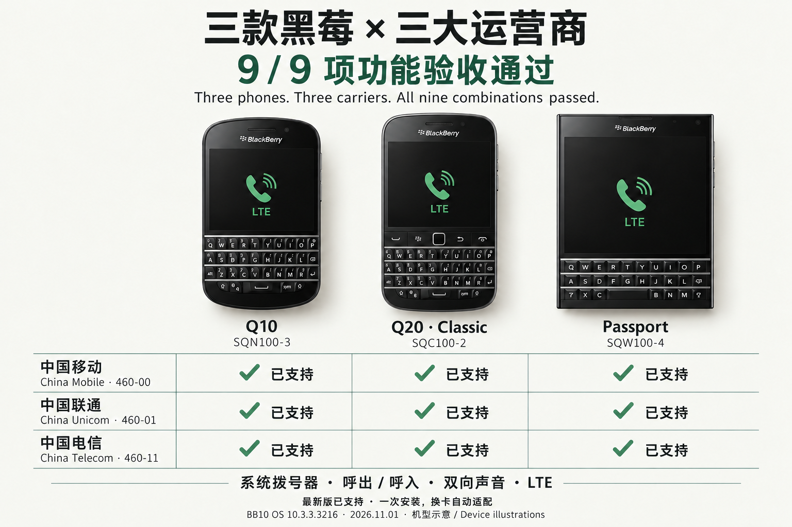

# bb10-volte — 让黑莓 Q10、Q20、Passport 用上 VoLTE


**简体中文** | [English](README.en.md)

首次连接 Windows 或 Mac 安装一次；以后正常关机换卡、开机，手机自动适配移动、联通、电信，无需再次连接电脑刷机。继续使用自己的 SIM、号码、套餐和系统拨号器，在 LTE 下接打电话。

**最新版已支持三款机型、三家运营商，当前仍为实验版。**适用于已 Root 的 **Q10 SQN100-3、Q20 SQC100-2、Passport SQW100-4**，系统 **10.3.3.3216**。Passport 切入或离开电信入网策略时，可能需要再正常重启一次；程序会解释原因并提示重新检查。

[使用指南](https://bb10-volte.octoooo.com/guide.html) · [发布与更新](https://github.com/Octo-o-o-o/bb10-volte/releases) · [更新日志](docs/UPDATELOG.md)

## 下载

| 电脑 | 系统要求 |
| --- | --- |
| Windows | **Windows 10 / Windows 11，64 位（x64）** |
| Mac · Apple 芯片 | **macOS 11 Big Sur 或更新版本** |
| Mac · Intel | **macOS 10.15 Catalina 或更新版本** |

**不支持 Windows 7、Windows 8 / 8.1 或 32 位 Windows。** Mac 通用 DMG 包含 Apple 芯片与 Intel 两种架构；**首次 Root 准备另需 macOS 14 或更新版本**。

上述 Mac 运行下限已按当前发布包内的原生程序和运行库核对，不代表旧版 macOS 或 Intel 已实机验证。Windows 11 x64 已完成打包与启动验证，Windows 10 x64 尚待实机验证；Mac 当前已在 Apple 芯片上运行，Intel 尚未实机验证。详见 [Windows 版说明](docs/WINDOWS-EXE.md)和 [Mac 版说明](docs/MACOS.md)。

官网默认使用 Cloudflare R2，无法访问 GitHub 也可下载。两处提供同版本、相同字节的文件；运行前核对完整 SHA-256。镜像提供独立线路，不保证所有地区和网络均可访问。

| 文件 | R2 直接下载 | GitHub 备用 |
| --- | --- | --- |
| Windows x64 EXE | [下载](https://bb10-downloads.octoooo.com/v0.5.0-r13/bb10-volte-0.5.0-r13-windows-x64.exe) | [下载](https://github.com/Octo-o-o-o/bb10-volte/releases/download/v0.5.0-r13/bb10-volte-0.5.0-r13-windows-x64.exe) |
| macOS universal DMG | [下载](https://bb10-downloads.octoooo.com/v0.5.0-r13/bb10-volte-0.5.0-r13-macos-universal.dmg) | [下载](https://github.com/Octo-o-o-o/bb10-volte/releases/download/v0.5.0-r13/bb10-volte-0.5.0-r13-macos-universal.dmg) |
| 完整源码 ZIP（含官网源码） | [下载](https://bb10-downloads.octoooo.com/v0.5.0-r13/bb10-volte-0.5.0-r13-experimental.zip) | [下载](https://github.com/Octo-o-o-o/bb10-volte/releases/download/v0.5.0-r13/bb10-volte-0.5.0-r13-experimental.zip) |
| SHA-256 校验码 | [查看](https://bb10-downloads.octoooo.com/v0.5.0-r13/SHA256SUMS.txt) | [查看](https://github.com/Octo-o-o-o/bb10-volte/releases/download/v0.5.0-r13/SHA256SUMS.txt) |

EXE / DMG 均内置 Python 和 Tk；Windows 同时内置 SSH/SCP，Mac 使用系统 SSH/SCP。Windows EXE 尚无 Authenticode 发布者签名。Mac 应用及 DMG 使用 Developer ID 签名、公证并附票；Intel 只核对包内架构，未在 Intel 实机运行。此前 r10 的 Mac＋Q20 连接和 USB 重连已通过；本次 r13 增加包级回归，不代表新增手机通话验收。

## 支持情况

**最新版已支持以下九项组合，均已通过实机功能验收。**



| 机型 / OS 10.3.3.3216 | 中国移动 | 中国联通 | 中国电信 |
| --- | --- | --- | --- |
| Q10 SQN100-3 | 已支持 | 已支持 | 已支持 |
| Q20 SQC100-2 | 已支持 | 已支持 | 已支持 |
| Passport SQW100-4 | 已支持 | 已支持 | 已支持 |

实测包括系统拨号器呼出、呼入、双向声音、LTE 通话和不连电脑换卡；本机号码与运营商显示也已验证。图中手机为机型示意。准确 SIM 范围为移动 460-00、联通 460-01、电信 460-11 的 USIM（无 ISIM）。

**短信收发和重复接收尚未实机验收。** 当前源码含短信 PS 配置与 [MT ACK 原生关联修复候选](docs/SMS-ACK-NATIVE.md)，已通过离线指令／ELF 检查，原生 ACK 候选默认关闭；历史证据和日志开关见[短信排查与取证](docs/SMS-DIAGNOSTICS.md)。

不同组合的测试时间和依据保留在[验收记录](materials/unified-carrier-acceptance.json)，包括初始卡与换卡测试、日志和机主确认的区别。其他硬件变体、系统版本、漫游、长期待机和紧急呼叫尚未完整验证。

## Windows 界面

`0.5.0-r13` 已增加[低版本 OS 升级与型号匹配](docs/FIRMWARE-UPGRADE.md)、手机授权命令前置检查及配套操作说明。升级会清空手机数据，须单独确认；旧系统真机升级闭环尚待验收。上述下载已包含这些新增流程。


真实程序界面，使用脱敏演示状态截图；它展示安装、重启后重新检查和完成入口，不作为实机测试证据。Windows 和 Mac 使用同一套自动适配流程。

## 快速开始

### 使用方式

1. 先确认手机准确型号、系统、已开通 VoLTE 的有效 USIM（无 ISIM）、Root SSH 与可信连接材料。**自动适配安装不等于首次 Root。**
2. 打开 Windows EXE 或将 Mac 应用拖入“应用程序”后启动。USB 连接并解锁一台手机，进入“三网自动适配”。
3. 核对当前设备，点击“备份并安装自动适配”。程序保存、下载校验原始配置，再安装、回读和启用。
4. 按手机电源菜单正常重启，解锁后等待约 3–5 分钟，点击“已重启，重新检查”。Passport 如提示还需一次正常重启，按原因说明完成。只有本次开机的 SIM、原生 IMS 注册和 LTE 均确认后才显示成功。
5. 拔掉 USB，用系统拨号器呼出、呼入，各等**接通后的屏幕计时达到 00:35**，核对双向声音、全程 LTE、运营商与自己的号码。
6. 以后正常关机换卡，再开机自动适配。Passport 切入或离开电信时，先等约 5 分钟，再正常重启一次。热插卡不在已验收流程内。

升级已识别旧载荷时，先停止并恢复旧设置、正常重启清除旧组件，再安装启用新版并正常重启。保留原始备份和升级回执。未知文件、备份缺失、通话中或独立设置冲突会阻止写入。完整说明见[三网自动适配](docs/AUTO-CARRIERS.md)。

### 首次 Root 与连接

已 Root 且有可信 SSH 的手机无需重新刷机。`0.5.0-r13` 已接入 Q10、Classic（Q20）、Passport（Q30）的自动 Root 准备和分阶段刷写。请按准确硬件型号选择对应固件；首次刷写会清空数据。Windows 三款固件的离线构建与校验已通过，新的向导首刷尚未在未 Root 手机上验收；Mac 原生流程仍需实机验收。准备至少 15 GB 空间。导入后点击“自动准备 Root 镜像”，完成后再确认刷写，见[首次使用](docs/FIRST-RUN.md)。

固件浏览器下载支持[极空间](https://t3.znas.cn/9jkbxczhAK4)及应用内百度网盘备用入口；下载后按机型校验导入，分享有效期以网页为准。它们与本页的 EXE/DMG 下载不同。见[首次使用](docs/FIRST-RUN.md)、[Mac 指南](docs/MACOS.md)和[连接说明](docs/GUI.md)。

### 源码运行与构建

```powershell
git clone https://github.com/Octo-o-o-o/bb10-volte.git
cd bb10-volte
python tools/check_release.py --check-git
python tools/gui.py
```

源码运行需要 Python 3.14（含 Tk）；完整 Root 准备使用该版本的 Zstandard 支持。原厂 `/radio/bin/ims_rrm` 不被覆盖，安装使用经过校验的独立副本；原生文件不匹配会停止。固定材料、上游来源与许可证见 [sources.json](materials/sources.json)及 [NOTICE](NOTICE.md)。

软件测试、冻结包自检、签名公证与真实手机通话分开验收。源码发布使用显式文件清单和敏感信息扫描；私钥、原始通信日志、号码与设备标识不在公开资料中。官网源码与测试见 [website/README](website/README.md)。

[Windows 打包](docs/WINDOWS-EXE.md) · [macOS 打包](docs/MACOS.md) · [源码构建](docs/BUILD.md) · [统一流程](docs/AUTO-CARRIERS.md) · [贡献说明](CONTRIBUTING.md) · [MIT 许可证](LICENSE)

历史单运营商适配、社区证据和旧版限制保留在各文档与更新日志，不能用来替代上面的当前统一流程范围。欢迎在 [Issues](https://github.com/Octo-o-o-o/bb10-volte/issues) 提交准确机型和脱敏结果；不要上传私钥、private 目录或原始号码日志。

## 分享与支持

安装并确认注册后，完成页提供中英文“分享给好友”、GitHub Star 和可选咖啡打赏。分享只复制文案与官网链接，由你自行发送；支付宝、微信均支持 ¥9.90 / ¥19.90 / ¥29.90 / 自定义金额，是否打赏不影响任何功能。详情见[完成与支持](docs/SUPPORT.md)。

开源包只包含程序、脱敏材料及明确的公共资源；不包含 SSH 私钥、原始设备日志、个人号码、原始收款截图或原厂固件。公开收款码使用 OctoLab 图标，保留原付款去向；扫码后请在支付应用中核对收款人和金额。

<sub>[项目官网](https://bb10-volte.octoooo.com/) · [OctoLab 出品](https://octoooo.com/) · [联系开发者](mailto:octoooo@octoooo.com)</sub>
