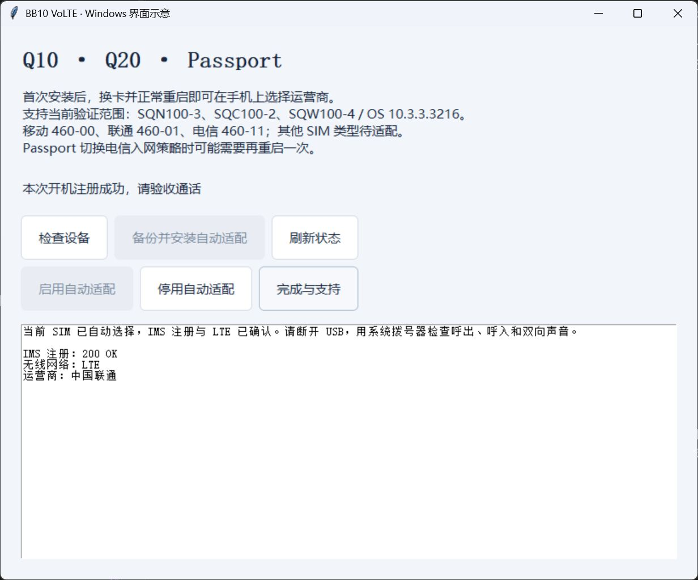

# bb10-volte — 让 Q10、Q20、Passport、P’9983 用上 VoLTE

**macOS 版停止维护（2026-11-09）：**由于维护精力有限，macOS 版封板于 **v0.5.0-r43**，后续不再维护或发布更新。该版安装包与源码继续保留下载。Windows 版和手机版不受此次调整影响。

**桌面 r43 · 手机版 0.1.0.43。** Q10、Q20、Passport、P’9983 的移动、联通、电信都能试。表里只标以前测得怎么样，不会因此拦住你。

机主说三网通过：SQC100-1、P’9983 SQK100-1。SQK100-2 还没测。SQW100-2 身份没核实。仍要 Root、系统 10.3.3.3216、对得上的原生文件，以及能恢复的备份。

[适配表](docs/COMPATIBILITY.md) · [本版说明](docs/RELEASE-r43.md)

## 这版改了什么

- 修复 Windows 打开、切页、拖动和缩放窗口时的明显卡顿；减少进度动画重绘。
- 重复准备 Root 镜像、导入固件和准备驱动时复用已校验材料，减少失败后的大文件残留。
- 增加存储位置与手动清理说明。手机版仍为 0.1.0.43，无需因桌面更新重新刷机或重装手机版。
- 电信短信送到了，手机仍可能显示“发送中”。别重发。有办法欢迎提 [PR](https://github.com/Octo-o-o-o/bb10-volte/pulls) 或发 [Issue](https://github.com/Octo-o-o-o/bb10-volte/issues)。

## 怎么用

- 没 Root：用 Windows 或 Mac。刷机会清空手机，先备份。
- 有 Root：装手机版，在手机里检查、备份、开启。之后不用连电脑。
- 应用让你重启再重启。换卡先关机。Passport 进出电信时，按提示再重启一次。
- 连电脑要开开发模式。只用手机要有 Root。认不到手机，先换能传数据的线。

## 重启后应用消失、开机亮蓝灯

少数 BB10 手机正常重启后会丢失应用或数据，并出现蓝色通知灯；这是手机系统/数据分区的历史问题，不是 VoLTE 激活造成的。历史修复工具、校验值和两台 Q10 的实测记录整理在 [bb10-blue-led-recovery](https://github.com/Octo-o-o-o/bb10-blue-led-recovery)。修复后请自己新建测试文件并正常重启确认，不能只凭工具提示“Fixed”就认为已经通过。

## 已刷 Android 11 的黑莓 Passport

本仓库（`bb10-volte`）仅针对原装 **BlackBerry 10（OS 10.3.3.3216 / QNX）** 系统（SSH/BAR 安装器 + `/radio/bin/ims_rrm` 运行时）。如果你的黑莓 Passport 已刷入 **Android 11（LineageOS 18.1）**，架构、传输通道和用户态 IMS 栈均完全不同，请使用独立发布的姊妹项目：

- 项目官网与直接下载：[passport-volte.octoooo.com](https://passport-volte.octoooo.com/)
- GitHub 开源仓库：[Octo-o-o-o/passport-android11-volte](https://github.com/Octo-o-o-o/passport-android11-volte)

## 下载

| 电脑 | 系统要求 |
| --- | --- |
| Windows | **Windows 10 / Windows 11，64 位（x64）** |
| Mac · Apple 芯片 | **macOS 11 Big Sur 或更新版本** |
| Mac · Intel | **macOS 10.15 Catalina 或更新版本** |

**不支持 Windows 7、Windows 8 / 8.1 或 32 位 Windows。** Mac 通用 DMG 包含 Apple 芯片与 Intel 两种架构；**首次 Root 准备另需 macOS 14 或更新版本**。

Windows 11 和 Apple 芯片试过启动。Windows 10 和 Intel 还没试。详见 [Windows 版说明](docs/WINDOWS-EXE.md)和 [Mac 版说明](docs/MACOS.md)。

反复准备或失败后磁盘占用较大时，见[保存位置与手动清理说明](docs/DISK-CLEANUP.md)。r43 已包含缓存复用与构建残留清理修复。

Windows 打开、切页和拖动窗口卡顿的[绘制修复与对照结果](docs/WINDOWS-UI-PERFORMANCE.md)已包含在下方 r45 下载中。

打不开 GitHub 时，用官网的 Cloudflare R2。两边是同一份文件，运行前对一下 SHA-256。

| 文件 | R2 直接下载 | GitHub 备用 |
| --- | --- | --- |
| Windows x64 EXE | [下载](https://bb10-downloads.octoooo.com/v0.5.0-r45/bb10-volte-0.5.0-r45-windows-x64.exe) | [下载](https://github.com/Octo-o-o-o/bb10-volte/releases/download/v0.5.0-r45/bb10-volte-0.5.0-r45-windows-x64.exe) |
| macOS universal DMG（r43 封板） | [下载](https://bb10-downloads.octoooo.com/v0.5.0-r43/bb10-volte-0.5.0-r43-macos-universal.dmg) | [下载](https://github.com/Octo-o-o-o/bb10-volte/releases/download/v0.5.0-r43/bb10-volte-0.5.0-r43-macos-universal.dmg) |
| 完整源码 ZIP（含官网源码） | [下载](https://bb10-downloads.octoooo.com/v0.5.0-r45/bb10-volte-0.5.0-r45-experimental.zip) | [下载](https://github.com/Octo-o-o-o/bb10-volte/releases/download/v0.5.0-r45/bb10-volte-0.5.0-r45-experimental.zip) |
| SHA-256 校验码 | [查看](https://bb10-downloads.octoooo.com/v0.5.0-r45/SHA256SUMS.txt) | [查看](https://github.com/Octo-o-o-o/bb10-volte/releases/download/v0.5.0-r45/SHA256SUMS.txt) |

EXE / DMG 均内置 Python 和 Tk；Windows 同时内置 SSH/SCP，Mac 使用系统 SSH/SCP。Windows EXE 尚无 Authenticode 发布者签名。Mac 应用及 DMG 使用 Developer ID 签名、公证并附票；Intel 只核对包内架构，未在 Intel 实机运行。r14 已增加 Mac／Q20 首次 Root，以及 Q20／联通与 Passport／移动短信和短时双向通话实测。

## Windows 界面

`0.5.0-r14` 已增加[低版本 OS 升级与型号匹配](docs/FIRMWARE-UPGRADE.md)、手机授权命令前置检查及配套操作说明。升级会清空手机数据，须单独确认；旧系统真机升级闭环尚待验收。上述下载已包含这些新增流程。



真实程序界面，使用脱敏演示状态截图；它展示安装、重启后重新检查和完成入口，不作为实机测试证据。Windows 和 Mac 使用同一套自动适配流程。

## 快速开始

下面是电脑上的安装步骤。手机已经 Root 时，直接装手机版。

### 在电脑上安装

1. 先确认手机准确型号、系统、已开通 VoLTE 的有效 USIM（无 ISIM）、Root SSH 与可信连接材料。**自动适配安装不等于首次 Root。**
2. 打开 Windows EXE 或将 Mac 应用拖入“应用程序”后启动。USB 连接并解锁一台手机，进入“三网自动适配”。
3. 核对当前设备，点击“备份并安装自动适配”。程序保存、下载校验原始配置，再安装、回读和启用。
4. 按手机电源菜单正常重启，解锁后等待约 3–5 分钟，点击“已重启，重新检查”。Passport 如提示还需一次正常重启，按原因说明完成。只有本次开机的 SIM、原生 IMS 注册和 LTE 均确认后才显示成功。
5. 拔掉 USB，用系统拨号器呼出、呼入，各等**接通后的屏幕计时达到 00:35**，核对双向声音、全程 LTE、运营商与自己的号码。
6. 以后正常关机换卡，再开机自动适配。Passport 切入或离开电信时，先等约 5 分钟，再正常重启一次。热插卡不在已验收流程内。

升级已识别旧载荷时，先停止并恢复旧设置、正常重启清除旧组件，再安装启用新版并正常重启。保留原始备份和升级回执。未知文件、备份缺失、通话中或独立设置冲突会阻止写入。完整说明见[三网自动适配](docs/AUTO-CARRIERS.md)。

### 首次 Root 与连接

已 Root 且有可信 SSH 的手机无需重新刷机。`0.5.0-r14` 已接入 Q10、Classic（Q20）、Passport（Q30）的自动 Root 准备和分阶段刷写。请按准确硬件型号选择对应固件；首次刷写会清空数据。Windows 三款固件的离线构建与校验已通过。r14 已完成 Windows／Passport SQW100-4 与 Apple 芯片 Mac／Q20 SQC100-2 的首次 Root、新密钥 UID 0、首次安装及正常菜单重启自动启动；原生阶段使用验收入口执行，完整 GUI 首次使用、Q10 首刷及 Intel USB 刷写尚未验收。准备至少 15 GB 空间。导入后点击“自动准备 Root 镜像”，完成后再确认刷写，见[首次使用](docs/FIRST-RUN.md)。

固件浏览器下载支持[极空间](https://t3.znas.cn/9jkbxczhAK4)及应用内百度网盘备用入口；下载后按机型校验导入，分享有效期以网页为准。它们与本页的 EXE/DMG 下载不同。见[首次使用](docs/FIRST-RUN.md)、[Mac 指南](docs/MACOS.md)和[连接说明](docs/GUI.md)。

### 源码运行与构建

```powershell
git clone https://github.com/Octo-o-o-o/bb10-volte.git
cd bb10-volte
python tools/check_release.py --check-git
python tools/gui.py
```

源码运行需要 Python 3.14（含 Tk）；完整 Root 准备使用该版本的 Zstandard 支持。原厂 `/radio/bin/ims_rrm` 不被覆盖，安装使用经过校验的独立副本；原生文件不匹配会停止。固定材料、上游来源与许可证见 [sources.json](materials/sources.json)及 [NOTICE](NOTICE.md)。

软件测试、冻结包自检、签名公证与真实手机通话分开验收。源码发布使用显式文件清单和敏感信息扫描；私钥、原始通信日志、号码与设备标识不在公开资料中。官网源码与测试见 [website/README](website/README.md)。

[Windows 打包](docs/WINDOWS-EXE.md) · [macOS 打包](docs/MACOS.md) · [源码构建](docs/BUILD.md) · [统一流程](docs/AUTO-CARRIERS.md) · [贡献说明](CONTRIBUTING.md) · [MIT 许可证](LICENSE)

历史单运营商适配、社区证据和旧版限制保留在各文档与更新日志，不能用来替代上面的当前统一流程范围。欢迎在 [Issues](https://github.com/Octo-o-o-o/bb10-volte/issues) 提交准确机型和脱敏结果；不要上传私钥、private 目录或原始号码日志。

## 分享与支持

安装并确认注册后，完成页提供中英文“分享给好友”、GitHub Star 和可选咖啡打赏。分享只复制文案与官网链接，由你自行发送；支付宝、微信均支持 ¥9.90 / ¥19.90 / ¥29.90 / 自定义金额，是否打赏不影响任何功能。详情见[完成与支持](docs/SUPPORT.md)。

开源包只包含程序、脱敏材料及明确的公共资源；不包含 SSH 私钥、原始设备日志、个人号码、原始收款截图或原厂固件。公开收款码使用 OctoLab 图标，保留原付款去向；扫码后请在支付应用中核对收款人和金额。

<sub>[项目官网](https://bb10-volte.octoooo.com/) · [OctoLab 出品](https://octoooo.com/) · [联系开发者](mailto:octoooo@octoooo.com)</sub>
